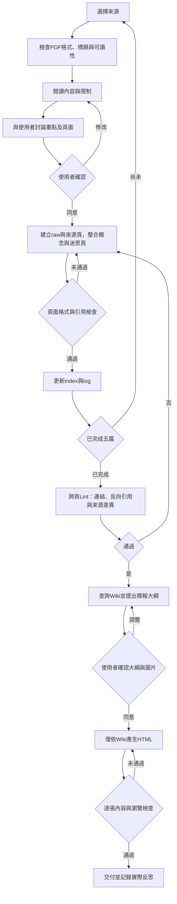

# 貓咪行為學：你真的懂貓咪嗎？

## 主題與介紹

建立給不熟悉貓咪的大學生閱讀的 LLM Wiki，以五篇研究與大學衛教資料整理尾巴、耳朵、眼睛、叫聲、身體姿勢和常見誤解。內容依據見 [Wiki導覽](wiki/index.md)。

## 目前完成的成果

- 5 篇 raw 來源紀錄、5 篇來源頁、6 篇概念頁、4 篇迷思頁。
- [Wiki導覽](wiki/index.md)與[操作紀錄](wiki/log.md)。
- [18張教學HTML簡報](slides/index.html)已依確認的大綱建立，附[簡報大綱](slides/outline.md)。目前為本機檔案，尚未發布，沒有公開網址。

## Loop / graph 設計

每完成兩篇匯入會做一次階段檢查。五篇完成後做跨頁檢查，再進入簡報階段。這樣設計可把書目、內容與引用的問題留在知識整理階段處理，避免在投影片中重複傳播。

## 一次實際執行的問題與調整

### 取得資料的阻礙

實際嘗試直接下載時，五個來源主機均出現名稱解析失敗。另一次 Chrome 電腦操作因無法可靠確認目前網址而停止。後來改用可用的內建瀏覽器，從官方頁面下載，並核對五個檔案的 PDF 檔頭、頁數與首頁內容。這是已發生的工具紀錄，不是臆測。

### 內容整合的問題

OSU 對快速擺尾的描述包含玩耍與衝突，UPEI 則強調不要直接視為開心。整合時將兩份來源的說法放入「不同來源的說法」，避免將情緒標籤寫成固定字典。UPEI 對貓群喵叫的描述較絕對，與回顧中的其他情境並列記錄。UPEI 未在講義中完整支持的呼嚕癒合敘述不納入教學結論。

### 本輪實際檢查與修正

第一次全站連結檢查發現兩條指向尚未產生之log.md的連結，已調整成先寫出紀錄再檢查。人工抽讀另發現證據標籤漏掉右括號，已修正知識頁與來源頁的輸出格式，raw依不刪改原文規則追加日期補註。重新執行連結與反向引用檢查通過。

### 哪個節點最常出錯？

就目前可觀察的執行紀錄，重複受阻最多的是「取得資料／工具存取」節點。內容整理也出現需要處理的情境差異，但尚沒有足夠次數支持它是最常出錯的內容節點。此處不把未來可能發生的簡報問題寫成已發生事件。

### 檢查往前移到哪裡？

取得檔案後先驗證格式、標題與頁數，再閱讀整理。寫入概念前先比較同一行為在不同來源的情境與限制。生成簡報前另做圖片文字核對，因現有插圖部分標籤比來源結論更強。

### 是否調整workflow？

已在本次執行增加兩個明確檢查點：取得資料後的檔案核對，以及跨來源整合前的情境比較。原專案 AGENTS.md 尚未修改。若要正式修改原專案規則，需另行確認並記錄 schema 更新。

## HTML 產出與檢查紀錄

使用者確認18張大綱後，已建立可離線開啟的投影片，含三題課前揭曉測驗、一題虛構情境練習、喵叫辨識率圖表、來源頁連結、流程及反思。

- HTML結構檢查：18張投影片、4個互動揭曉區、4張SVG圖片，通過。
- 相對路徑與圖片替代文字：通過，未發現缺失目標。
- JavaScript語法檢查：通過。無外部字型或程式庫依賴。
- 圖片文字核對：耳朵圖移除未由本次來源支持的心情標籤；尾巴圖保留情境用語；慢眨眼圖移除直接等同微笑的標題。
- 桌面與手機畫面驗收：尚未完成。預覽工具無法連到本機服務，且禁止直接開啟file網址，沒有繞過限制。
- 換頁、觸控、全螢幕與列印：已實作，尚未在實際瀏覽器完成操作驗收。HTML列印版會展開答案，但列印分頁仍需實際確認。

完整機器檢查結果見 [簡報檢查報告](slides/check-report.json)。因瀏覽器預覽受阻，不能將本次語法與連結檢查描述為視覺驗收通過。

## 開啟與繳交

解壓縮後開啟slides/index.html。按上一張、下一張或方向鍵換頁，使用下拉選單跳頁；總覽可閱讀全部頁面，小測驗可點選展開。手機窄螢幕使用單欄排列，內容較長時可向下捲動。

這是本機成果，不是公開網站。若作業需要公開網址，仍需另行部署。本套件不包含原始PDF全文。assets中沿用的使用者既有示意圖，其公開再散布權利仍需由使用者確認。
